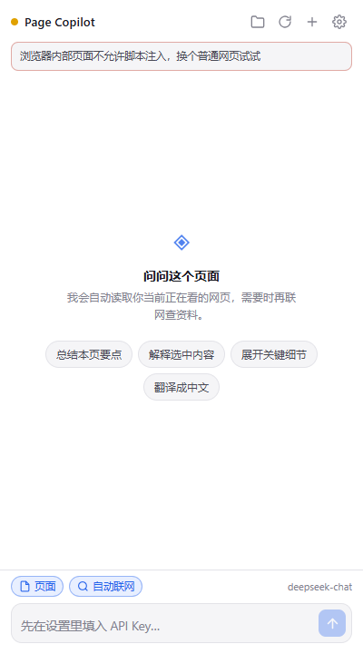
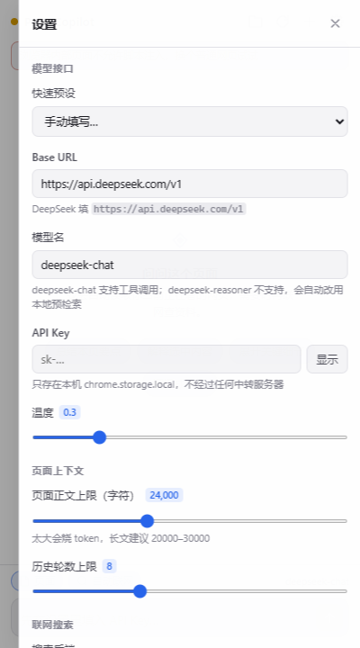

# Page Copilot · 网页侧边栏助手

一个 Edge 侧边栏扩展，形态对标内置 Copilot：**读你正在看的网页或 PDF → 结合上下文回答 → 需要时自己联网查资料**。

默认接 **DeepSeek**，但任何 OpenAI 兼容接口都能用（官方 OpenAI / 硅基流动 / 本地 Ollama、vLLM）。

<p align="center">
  
  
</p>

> 上图是在真实 Edge 里加载本扩展后截的。顶部红色提示是**正确行为**——当时活动标签页是扩展自身页面，不允许注入，所以明确告诉你而不是静默失败。

---

## PDF 支持（重点）

Edge 内置的 PDF 阅读器是个独立的受保护环境，**脚本注入进不去**，所以常规"读页面"的做法对 PDF 完全无效。

这里的做法是绕开它：直接下载 PDF 本体，用打包进来的 **pdf.js** 在侧边栏里解析文本层。所以你可以在 PDF 页面直接问"这篇讲了什么""第 3 页的公式在说什么"。

- **中英文都支持**：带了完整的 CMap（Adobe-GB1 / Adobe-CNS1 等 169 个）和 standard_fonts，中文 PDF 不会解析成空白或乱码。
- **本地文件也能读**：`file://` 打开的 PDF 会自动读取（需要在扩展详情里打开「允许访问文件 URL」）。**即使不开这个权限**，也可以点顶栏的文件夹按钮选择文件，或直接把 PDF 拖进侧边栏——这条路不依赖任何权限。
- **按页组织**：正文按 `[第 N 页]` 分页，模型引用会带页码。
- **问哪页就给哪页**：问「第 52 页讲了什么」或「翻译第 52 页」，该页会被**强制**放进上下文，不受长度上限影响。
- **超长文档不会腰斩**：按 token 预算而不是字符数算 —— 英文 82 页约 3.2 万 token，一次就能整本塞进去（以前按 24000 字符砍，后半本直接没了）。真的塞不下时才挑页。
- **塞不下就挑页 + 给目录**：按你问题的关键词给每页打分，选最相关的页，并附上全文档每页首行的目录，让模型知道整本结构。
- **总结类问题走分段通读**：问「总结全文」这类需要全局视野的，会自动把全文切块逐段阅读，再汇总成一份回答（会显示"第 3/6 段"的进度）。
- **拿得到就要登录的 PDF**：下载时带 cookie（`credentials: include`），登录后才能看的 PDF 也能读。
- 实测：14 页英文学术论文（pdf.js 解析 ~250ms）/ 中文排版文档，都能正确还原段落，中英文混排、上标脚注、硬换行都处理过。

**做不到的**：扫描件（图片版 PDF）没有文本层，读不出字，会明确提示需要 OCR；页面用 `blob:` 临时地址生成的 PDF 拿不到文件本体（这种请用文件夹按钮选文件）；有密码的 PDF 打不开。

> **一个重要限制**：浏览器不会把 PDF 阅读器的**滚动位置**暴露给扩展，所以它不知道你此刻滚到第几页。问「这页讲了什么」时请顺便说页码（「第 52 页」），或者干脆把这一页的文字选中后问。这不是懒，是 Edge 没给这个接口。

> 首次在 PDF 页面打开侧边栏会自动开始解析，页面条会显示"14 页 · 48,037 字"这样的进度和结果。

---

## 为什么不用现成的（比如 Page Assist）

Edge 商店里能打的确实有 —— [Page Assist](https://microsoftedge.microsoft.com/addons/detail/page-assist-a-web-ui-for-local-ai-models/ogkogooadflifpmmidmhjedogicnhooa)（94k+ 用户，MIT 开源，支持 DeepSeek）。它很适合本地模型玩家，但对你这个场景有三个硬伤：

| | Page Assist | 本扩展 |
|---|---|---|
| 网页上下文 | 需要手动开 "Chat with Website"，默认走 RAG 要配 embedding 模型（DeepSeek 没有 embedding 接口） | 每次提问**自动**抓当前页面，纯文本直塞，零配置 |
| 用户此刻在看哪 | 不区分 | 单独标记**视口内文字**，"这段""这里"能对上 |
| 联网搜索 | 要自建 SearXNG 之类的搜索服务 | 内置 Bing / DuckDuckGo，免 Key 开箱即用，失败自动切换 |
| 体积/复杂度 | 全功能大件 | 只做这件事，约 2000 行，全部可读 |

如果你只想 5 分钟用起来、也不介意搭搜索服务，Page Assist 是好选择。要"装了就能问、问了就联网"，用这个。

---

## 安装（Edge 侧载，约 1 分钟）

1. 打开 `edge://extensions/`
2. 左下角打开 **开发人员模式**
3. 点 **加载解压缩的扩展**，选择 `edge-page-copilot` 目录（或解压 `dist/edge-page-copilot-1.0.0.zip` 后选解压目录）
4. 工具栏点扩展图标 → 侧边栏打开（或按 `Alt+Shift+P`）

> 没上商店是因为上架要开发者账号 + 审核，侧载功能完全一致。

## 配置 DeepSeek（30 秒）

首次打开会自动弹出设置面板，也可以点右上角齿轮：

| 项 | 填什么 |
|---|---|
| **Base URL** | `https://api.deepseek.com/v1` |
| **模型** | `deepseek-chat`（支持工具调用，推荐） |
| **API Key** | 你的 `sk-...`（[platform.deepseek.com](https://platform.deepseek.com/api_keys) 申请） |

也可以在"快速预设"里点 **DeepSeek**，前两项自动填好。

保存后页面信息条会变绿，就可以问了。

> `deepseek-reasoner` 也能用，但它不支持 function calling，扩展会自动改用「本地预检索」——先把搜索结果塞进上下文再问，效果一样。
> 想显示它的思考过程：设置里勾上「显示 deepseek-reasoner 的思考过程」。

---

## 怎么用

- **直接问**：说话就行，页面内容自动带上。问"这篇文章的核心结论是什么"、"作者说的第三点是什么意思"。
- **PDF**：在 PDF 页面上打开侧边栏，它会自己开始解析（页面条显示进度），之后正常提问即可。问"第 12 页讲了什么"会自动把那页补进上下文。
- **选中即问**：先在网页里划选一段，再在侧边栏问"这段话什么意思" —— 选区会作为重点上下文，和视口文字分开标注。
- **联网**：底部「自动联网」按钮三态循环
  - `自动联网`（默认）：模型自己判断要不要搜，页面里够答就不搜，省 token
  - `强制联网`：每次提问先搜一轮，适合问时效性内容
  - `不联网`：完全不搜，纯页面 + 模型知识
- **深读某条结果**：搜索之后模型可以自己调 `read_url` 去抓全文（设置里可关）。
- 消息下方能看到 token 消耗、耗时，可一键复制；生成中可随时中止。

## 隐私

- API Key 只存在本机 `chrome.storage.local`，**只发给你自己配的接口地址**，没有中转服务器，没有任何遥测。
- 对话存在 `chrome.storage.session`，**关浏览器即清空**。
- 页面内容只在你点发送时才会读取并传给模型；不发消息就不读。
- 联网搜索由扩展本地发起（Bing / DDG），不经过第三方聚合服务。

**权限说明**（安装时会看到提示）：

| 权限 | 用途 |
|---|---|
| `sidePanel` | 侧边栏本体 |
| `scripting` | 注入脚本读取网页正文 |
| `tabs` | 知道当前是哪个标签页、切换时刷新 |
| `storage` | 存设置和会话 |
| `<all_urls>` | 读任意网页正文 + 请求你配置的 API 和搜索站 |

---

## 已知限制

- **读不到**：`edge://` 等浏览器内部页、扩展商店页、纯 Canvas/图片页。会明确提示，不会静默失败。
- **PDF 扫描件**：没有文本层，需要 OCR，目前会直接告诉你读不了（不会硬编内容）。
- **页面用 `blob:` 生成的 PDF**：那个地址属于原页面源，扩展拿不到文件本体。点顶栏文件夹按钮选文件即可。
- **本地 PDF 自动读取要权限**：`file://` 依赖「允许访问文件 URL」。不开也行——用文件夹按钮或直接把文件拖进侧边栏。
- **纯 JS 渲染的页面**（部分 SPA）提取效果取决于 DOM 里有没有真实文本；`read_url` 抓这类页面也容易拿到空壳。
- **搜索可能被风控**：Bing / DDG 都是抓公开结果页，高频使用可能被限流。真要紧的场景建议配 Tavily Key（每月有免费额度），质量也更好。
- 长页面按 `页面正文上限` 截断，默认 24000 字符；截断时会**优先保住你视口内的内容**并标注。PDF 走两倍上限（默认 48000 字符）。
- 没有多会话管理（点 + 开新对话会清空当前），没做导出。

---

## 开发与测试

```bash
# 全部单测（75 项，无需浏览器）
node tests/run.mjs

# 只跑某一类
node tests/run.mjs tests/extract.test.mjs

# 真实 Edge 加载冒烟测试（25 项，需要本机 Edge + playwright-core）
NODE_PATH=<含 playwright-core 的 node_modules> node tests/browser-smoke.mjs
```

| 文件 | 覆盖 |
|---|---|
| `tests/util.test.mjs` | 文本/SSE/搜索结果解析、配置归一化（用真实抓取的 DDG/Bing 页面做 fixture） |
| `tests/pdf-text.test.mjs` | PDF 碎片 → 行 → 段落的重组：中英文补空格规则、自适应行距、字号层级、列表识别、页码标记 |
| `tests/extract.test.mjs` | 页面提取。用 `toString()+eval` 模拟真实注入，验证函数自包含、噪音过滤、视口标记、截断保视口、选区、去重 |
| `tests/agent.test.mjs` | 工具循环：多轮 tool call、工具抛错、轮次上限、消息格式 |
| `tests/pipeline.test.mjs` | 端到端：本地起假 DeepSeek 服务，走真实 HTTP+SSE，验证流式拼接、tool_calls 分片、402/401 错误、中断、reasoning |
| `tests/markdown.test.mjs` | Markdown 渲染 + **XSS 防护**（模型输出不可信，`javascript:`/`<script>`/属性注入全部挡掉） |
| `tests/manifest.test.mjs` | 扩展完整性：图标尺寸、权限与代码一致、`$()` 的 id 存在、import 可解析、语法检查、SW 不碰 DOM、pdf.js 资源齐全 |
| `tests/search-live.test.mjs` | 真实联网（断网自动 skip，带重试） |
| `tests/browser-smoke.mjs` | **真实 Edge 加载扩展**：manifest 被接受、SW 启动、UI 渲染无报错、`chrome.scripting` 真实注入活动标签页、**真实 PDF 与现场生成的中文 PDF 解析** |

当前状态：**单测 99 通过 / 1 跳过 / 0 失败；Edge 冒烟 30/30 通过**。

> 跳过的那 1 项是 DuckDuckGo 单独联调 —— 实测 Node 的 TLS 指纹会被 DDG 拒（0/5），但浏览器里正常，所以测试里标了 skip 而非放宽断言。也正因为这个，默认搜索后端定成了实测 5/5 的 Bing。

> 提取测试需要 `jsdom`。`tests/run.mjs` 会自动去 Node 的 workspace 找；找不到就用 `PC_NODE_MODULES=<路径>` 指定。

### 目录结构

```
edge-page-copilot/
├── manifest.json              MV3 清单
├── icons/                     16/32/48/128（tools/make-icons.py 生成，纯标准库）
├── vendor/pdfjs/              pdf.js 5.4（472KB 主程序 + 1.1MB worker + CMap + 字体，共 3.7MB）
├── src/
│   ├── background.js          service worker：抓页面 / 调模型 / 工具循环 / 端口通信
│   ├── lib/
│   │   ├── extract.js         注入页面的正文提取函数（必须自包含）
│   │   ├── pdf-text.js        PDF 碎片 → 行 → 段落（纯函数，可单测）
│   │   ├── openai.js          OpenAI 兼容流式客户端
│   │   ├── agent.js           工具调用循环
│   │   ├── search.js          多后端检索 + read_url
│   │   ├── util.js            纯函数工具层
│   │   └── markdown.js        Markdown 渲染（自带转义）
│   └── sidepanel/
│       ├── index.html
│       ├── style.css
│       ├── app.js             界面逻辑
│       └── pdf-loader.js      PDF 下载 + pdf.js 解析（只能在有 DOM 的页面跑）
├── tests/                     见上表
└── tools/                     图标生成、打包
```

### 扩展点

想加功能不用改核心：

- **换模型/换厂商**：设置里改 Base URL + 模型名即可，代码不用动。
- **加工具**：在 `background.js` 的 `buildTools()` 里加 function 定义，在 `runTool()` 里加分支 —— 循环逻辑在 `lib/agent.js`，不用碰。
- **换搜索源**：`lib/search.js` 里加一个 `searchXxx`，在 `searchWeb` 的降级链里注册。
- **改 PDF 排版规则**：只是 `lib/pdf-text.js` 里的 `linesToText`，纯函数，改完 `node tests/run.mjs` 立刻能验证。
- **改人设**：设置里的「自定义系统提示词」会整体替换内置提示词。

---

## 版本

v1.1.2 · 无账号、无遥测、无中转。
